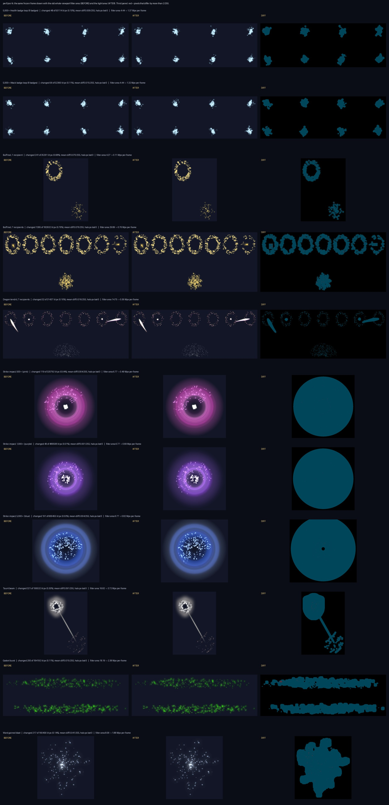

# 2026-11-18 — Pixi FX: filters on particle layers ran over the whole screen

Owner bar: over 240 fps (frames at or under 4.17 ms) at all times, no hitching. After the combat render path
(#2781, which this branch is stacked on) the time inside long frames was led by the Pixi FX layer. This pass
profiled that layer and fixed what the profile showed, with the look held. Rules: R-PERF-FX-FILTER-AREA-01,
R-PERF-FX-DEAD-TAIL-01, R-PERF-FX-FILTER-KEYS-01.

## What was wrong

1. **Every filter on a particle layer filled the whole viewport.** A `ParticleContainer` has no measurable bounds: it
   reports the `boundsArea` it is given, and ours was a 2,000,000 px box (`PARTICLE_BOUNDS_HALF_EXTENT`, widened in the
   past so a filter would not slice far-flung sparks). Pixi clips a filter to the viewport, so each pass of a Bloom or
   Glow on a 60 px spark burst cleared, drew and sampled 1920 x 1080 pixels. The generic buff trail
   (`rune-buff-trail`) has two filtered bursts per play; a grant to a full board is 28 filters over **28 megapixels a
   frame** for its whole 1.4 s. This is E1's cause 4 (the shop slowing on every Ancient stat grant) and most of
   `fx:render` in a late fight.
2. **The 5,000+ stat ring carried invisible particles.** `test-ascent-frame-health` / `-attack` (the heaviest effect
   in the long fight by measured time, 5.1 s of a 40 s fight) is an emitter whose size curve reaches 0 at 57% of a
   mote's life and stays there. The last 43% of every mote was simulated (turbulence, four curve samples), uploaded and
   drawn at zero size.
3. **Every live layer built 32 key strings a frame.** `FilterStack.frame` walked the whole filter registry per layer
   per frame building `` `${id}On` `` to ask whether each filter was on, for layers that mostly carry none (about
   1.9 s of a 40 s fight in the unminified profile: `bool`, `frame`, `orderedIds`, `num`).

## What changed

- **Tight filter areas.** `fitParticleBounds` (particleLayerPool.ts) writes the box of the live particles (grown by
  the largest quad's diagonal) into the layer's `boundsArea` at the end of burst / emitter / smoke `update`, but only
  when a filter above the layer will read it. `FilterStack` takes a `tight` flag (the three particle primitives, and a
  shared filter group whose def draws particles). A tight stack pads each filter by its real reach where the filter
  does not do so itself (Bloom is an Alpha filter around two blur passes and has padding 0; Advanced Bloom and RGB
  Split likewise), and it is only tight while every filter on it is in `TIGHT_FILTERS`: the ones whose result does not
  depend on where the area starts or how big it is. Godrays, zoom / radial blur, twist, shockwave, CRT, pixelate and
  the rest keep the whole viewport, as does any layer under a filter that something else put on an ancestor (the
  `custom` primitive's root displacement).
- **A Pixi 8.19 defect, fixed in place** (`blurPassClear.ts`). Tight areas made it visible: `BlurFilterPass
  ._applyOptimized` never clears its pooled scratch texture on WebGL, so a later, smaller filter sampled what an
  earlier, larger one left outside its frame and drew a faint L of stale glow along its right and bottom edge. The
  legacy path cleared on the first pass; the replacement restores that one clear. It checks the shape of the method it
  replaces, and if a future Pixi differs it does nothing and tight areas stay off (the old behaviour). A test pins
  pixi.js 8.19 so an upgrade re-reads it.
- **Invisible-tail cull** (`emitter.ts`, `zeroTailStart` in curve.ts). A mote past the zero tail of its size or alpha
  curve leaves the sim and the draw list. Its remaining life is kept as a plain number so the 1,200-mote cap and the
  completion moment are exactly what they were.
- **Prebuilt filter keys** (`filterStack.ts`). Keys per spec, built once; one id map per registry instead of per
  stack; no array allocated for a layer with no filter on.

## Proving the look

A bench build honours `globalThis.__fxTightOff = true`. The checker freezes the ticker, plays a def, steps it to a
time, then draws **the same frozen frame twice**, once with the old unbounded area and once tight, and compares the
canvases pixel by pixel. A control draws the old mode twice to measure what changes with no code difference (the
particle shader's time-driven noise). All 53 defs that carry a filter on a particle layer, 59 plays (trails also
7-wide, badge loops as 8 shared), 175 frames:

- halo pixels lost or gained: **0** in 174 frames, 1 pixel in one;
- largest mean difference over lit pixels: **0.99 of 255**; typical 0.01 to 0.2;
- pixels differing by more than 2/255: at most 2.5% of lit pixels, in frames where the control differs too. The
  remainder is band-edge rounding: the particle shader posterises into bands, and drawing into a different-size target
  moves a few band edges by one pixel;
- filter area summed over those frames: **1,391 -> 199 megapixels**.

The first run of this check is what found the stale-glow L. Before/after crops are in the contact sheet above and in
the worktree's `shots/perf-pixi-fx/`.

## Numbers

Headless Chrome, prod build, hardware GL (D3D11), RTX 4080 SUPER, 1920 x 1080, frame rate uncapped. **Other builders
were benchmarking on this machine throughout**: the same build's share of frames over 4.17 ms ranged from 13.6% to
39% across runs. Runs were interleaved; structural counts (megapixels, particles) are exact, frame times are not.

**A 7-wide buff trail in the shop** (`rune-buff-trail` to seven targets every 1.5 s, 9 fans; 2 runs each):

| | before | after |
|---|---|---|
| filter area per frame | 28.0 Mpx | 0.75 Mpx |
| frames over 4.17 ms | 40.0%, 44.5% | 0.7%, 1.3% |
| frames over 6.25 ms | 33.0%, 37.9% | 0.3%, 0.5% |
| p95 / p99 frame | 15.4-17.4 / 19.7-25.1 ms | 2.5-2.6 / 3.7-4.6 ms |
| `fx:render` per frame | 3.9 ms | 0.47 ms |
| frames drawn in the same 13.5 s | 2,243 - 2,461 | 8,011 - 9,022 |

**The long 7v7 late fight** (the #2781 bench scene, 355 events, 40 s; medians of 3 interleaved runs):

| | before | after |
|---|---|---|
| filter area per frame | 14.0 Mpx | 3.0 Mpx |
| `fx:tick` per frame | 2.51 ms | 2.08 ms |
| `fx:sim` total | 15.2 s | 14.4 s |
| frames over 4.17 ms | 33.4% | 31.1% |
| frames over 6.25 ms | 21.5% | 19.2% |
| p99 frame | 18.8 ms | 19.7 ms |
| long tasks | 11 | 8 |

The fight moves less than the shop fan because it holds fewer filtered particle layers at once, and its frame-time
change is inside the run-to-run noise. Its filter fill is down 4.6x, which is what a weaker GPU feels.

## Measured and not shipped

- **Reading the badge's position after layout instead of inside the FX tick.** The profile's largest single item is
  `getBoundingClientRect` in the stat ring's follow (4.8 s of 40 s). A ResizeObserver-driven sampler removed it from
  `fx:sim` (15.4 s -> 8.7 s), but total style recalc only fell 5.1 s -> 4.6 s while layout rose 0.65 s -> 1.05 s: the
  read is the frame's own style pass pulled forward, not extra work. No frame-time gain was measurable, and it put
  the ring one frame behind its badge. Parked.
- **Zero-amount filters on keyword beams** (S3 F11). Bloom at strength 0 is not a no-op (it screens a copy), so it is
  Mike's call in the defs. Their particle layers are tight now (`taunt-beam` 16.8 -> 3.7 Mpx a frame).

## Still open (owner calls)

1. **One filter pass for a whole fan.** A 7-wide trail still runs 28 filters (7 ribbon Blooms of about 9 passes each).
   One Bloom + Glow over a container of all seven ribbons would be a quarter of the passes. Bloom is the same picture;
   Glow is weaker where the ribbons overlap at the source. Needs a look decision.
2. **Fan particle budget for the trails.** 262 particles a play, 1,834 for a full board. Sharing a budget thins the
   sparks on wide fans.
3. **The stat ring as a baked flipbook.** It is still about 0.4 ms a frame with 8 badges up (particle maths). Baking
   its loop to a sprite sheet would make it nearly free, but every ring would then be the same loop.
4. Particle maths (turbulence, curve samples, buffer uploads) is now the bulk of `fx:sim`: about 4,300 particles at
   the fight's peak.

## Files

`packages/ui/src/fx/`: `filterStack.ts`, `particleLayerPool.ts`, `blurPassClear.ts` (new), `sharedFilters.ts`,
`fxRuntime.ts`, `playDef.ts`, `curve.ts`, `primitives/{burst,emitter,smoke,index}.ts`; tests
`filterAreaTight.test.ts` (new), `curve.test.ts`, `primitives/emitter.test.ts`.
